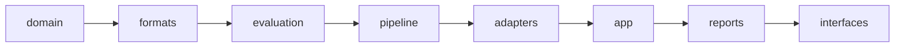
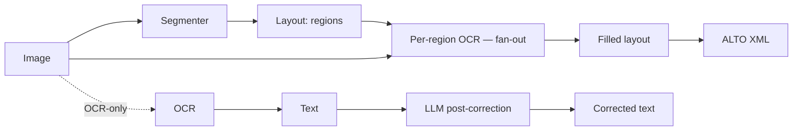

<div align="center">

# Cinoc

[](https://github.com/maribakulj/cinoc/actions/workflows/ci.yml)
[](https://www.python.org/)
[](LICENSE)
[](#development)
[](https://github.com/astral-sh/ruff)
[](https://mypy-lang.org/)
[](#invariants)

**A reproducible benchmark for transcription *pipelines* — OCR, HTR, VLM, OCR→LLM — on heritage documents.**

Cinoc runs competing transcription pipelines over a ground-truth corpus and produces a **factual, quantified verdict** — metrics plus statistical tests — as a **self‑contained interactive HTML report**. No LLM writes the report: every number is an **auditable** function of the inputs.

</div>

---

## Why Cinoc exists

Transcribing heritage documents — medieval manuscripts, early printed books, 19th‑century press — is no longer a single OCR call. It is a **pipeline**, and AI has multiplied the ways to build one:

- an **OCR** engine feeding an **LLM** post‑corrector — does the LLM *fix* errors, or *invent* plausible text the original never contained?
- a **VLM** transcribing straight from the image, with or without **layout segmentation** first;
- a **post‑correction LLM** paired with **anti‑hallucination** measurement — how much does it rewrite that was already correct?

Existing OCR benchmarks were not built for this. They assume one engine, clean modern text, and a single error rate. Heritage material breaks all three assumptions, and **AI breaks the metrics themselves**:

- **CER/WER are no longer enough.** A pipeline can lower the character error rate while *hallucinating* named entities, destroying diacritics, modernising archaic spellings, or mangling dates and folio numbers — exactly the things a historian actually cites.
- **A pipeline that wins on one corpus loses on another.** What is best for 19th‑century print is not what is best for a 15th‑century hand.
- **The "best" pipeline depends on who is asking.** An institution may weigh **cost**, **throughput**, results **per region** vs **per page**, or robustness on a specific stratum — differently. Cinoc never declares a winner; it gives you the numbers and the significance tests, and the judgement stays yours.

Cinoc is the bench you run **before** committing a corpus to a pipeline: reproducible, engine‑agnostic, and honest about what it does and does not measure.

*(Screenshots are at the [bottom of this page](#screenshots).)*

---

## What you can build and measure

### Pipelines (composed, not hard‑wired)

| Pipeline | What it does |
|---|---|
| **OCR / HTR** | Tesseract · Kraken · Pero · Calamari · Mistral OCR · Google Vision · Azure Document Intelligence |
| **OCR → LLM** (`text_only`) | an OCR engine, then an LLM corrects the text |
| **OCR → VLM** (`text_and_image`) | an OCR engine, then a VLM sees **image + text** together |
| **VLM zero‑shot** | a VLM transcribes the image directly, no OCR upstream |
| **Image preprocessing** (`image → image`) | deskew and binarise before reading, so you can measure whether restoring the page actually lowers the error rate — instead of asserting it from a quality score. The angle is **searched**, the threshold is **computed from the image** (Otsu); no magic constant decides anything. |
| **Reading order** (`layout → layout`) | put the blocks back in the order a human reads them. On a two‑column page, reading top‑to‑bottom interleaves the columns and the text becomes unusable — a dedicated metric (Kendall distance) attributes that damage to the *ordering*, where CER alone cannot tell it apart from a bad transcription. |
| **Hybrid** (seg → reco → ALTO) | layout segmentation → recognition **per region** (fan‑out) by **any OCR or a VLM (zero‑shot) per block** → assembled ALTO XML |
| **Structured post‑correction** (ALTO → ALTO) | take **existing** ALTO and correct it *inside* the layout — every line keeps its identifier, so before/after is **known**, not guessed by aligning two lists of lines. Rules (offline, deterministic) or a local LLM via Ollama. |
| **Chained correction** (`corrected_text → corrected_text`) | a second corrector picks up where the first left off — a fast pass then a careful one, or structured correction then textual. The `refine` mode is the only one whose input *and* output are corrected text, which is what makes a chain expressible at all. |
| **Engine fusion** (N × `raw_text` → `raw_text`) | run several engines and **combine** them by per‑token majority vote, instead of only ranking them. It fixes what one engine gets wrong where the others are right — and is powerless when they all fail the same way, which is exactly what the bench is there to tell you. |
| **PAGE XML export** (`layout → page_xml`) | the format eScriptorium, Transkribus and OCR-D read back. Unlike ALTO, PAGE carries the **reading order explicitly** — so an order you corrected survives the export instead of having to be baked into the block sequence. |
| **+ NER** (optional terminal step) | `text → entities`, scored if the corpus carries entity ground truth |

Engines are **interchangeable bricks** behind a single `Module` protocol. Heavy dependencies are **optional extras**: an engine is always listed, and tells you clearly if it needs its extra or API key instead of crashing.

### Metrics (built for the AI era)

Far beyond CER/WER — every family ships with its own report section, and every metric declares its **category** and its **unit**:

- **established** — conforms to a named reference and is checked against an oracle (CER, WER, MER against jiwer; cMER against the HIPE‑OCRepair scorer). Only these are **ranked** and enter the **significance tests**;
- **adapted** — a justified variant of a named reference (diplomatic CER, bag of words, full‑text recall, FCA…);
- **exploratory** — no named reference yet (unanchored trigrams, archaism rates, numerical sequences…). Not wrong — just not valid enough to rank on. Adapted and exploratory metrics stay **diagnostic**, marked as such in the report.

The families:

- **Character / word** — CER, diplomatic CER, WER, MER, median/min/max, Gini concentration.
- **Philology** — diacritics, MUFI (Medieval Unicode) overlap, abbreviations, early‑modern forms, modern‑archive conventions, Roman numerals, archaism rates (AIR/HCPR).
- **HIPE conformity** — cMER under the HIPE‑OCRepair norm, micro/macro, JSONL export.
- **Correction balance** *(the "did the LLM help?" family)* — improvement/regression/no‑change triplet, pcis, change ratio (CCR), **over‑normalisation** (correct words the corrector degraded), **heavy‑insertion** flags, consecutive‑edit runs, worst regressions. When the corrector reports its own **decisions**, the report also shows what it *refused* to change, and why — a refusal is a result, not a silence.
- **Line identity** — when a pipeline preserves line identifiers (structured post‑correction), before/after are matched **by id** instead of being guessed by alignment: per‑line CER and coverage stop depending on a heuristic.
- **Structured data** — survival of dates, foliation, amounts, regnal years (strict form *and* equivalent value).
- **Textual fidelity** — rare‑token recall, lexical modernisation flow.
- **Named entities (NER)** — precision/recall/F1 per category, missed & hallucinated entities, IoU span matching in GT coordinates, plus an **exact‑name** F1 (a misread name is a lost name).
- **Inter‑engine** — Jensen‑Shannon divergence, oracle gap, complementarity; **Wilcoxon / Friedman / Nemenyi** significance and bootstrap CIs.
- **Per‑line distribution** — percentiles, Gini, catastrophic‑line rate, positional heat‑map.
- **Calibration** — ECE / MCE on engine confidences.
- **Image quality** — sharpness, noise, contrast, skew (per document).
- **Economics** — **measured** tokens × dated price table + **measured** wall‑clock → cost and effective throughput, Pareto fronts, marginal cost per avoided error (no invented CO₂, no estimates).
- **Longitudinal** — OLS trend + Pettitt change‑point across runs (on the `/history` page).

> Levels that don't apply return **`None`**, never a misleading `0` — an absent measurement is reported as absent.

---

## Invariants

- **Deterministic scoring** — same outputs + same spec + same code → identical metrics and verdict. Replaying frozen outputs (`precomputed`) gives identical artifacts (same hash); two reports differ only by their timestamps and measured durations.
- **Traced, not guaranteed, inference** — a remote or stochastic engine (cloud API, LLM/VLM, even at temperature 0) is *not* deterministic: Cinoc records what was asked and measures the spread (`--repeat`), it does not promise the same transcription twice.
- **Reproducible** — every run carries a `RunManifest`: code version, the effective settings of every module (requested model, prompt, defaults, endpoint), module versions, engine binaries, the **model the provider says it served**, the installed Python distributions (`dependencies_lock`) and the Unicode database version the normalisation depends on.
- **Anti‑hallucination** — no LLM writes a single word of the report; every figure is an auditable function of the inputs.
- **Secure** — hardened XML (`safe_parse_xml`: no DTD/DOCTYPE/external entity/network), all user paths validated (anti‑traversal), anti‑SSRF on remote fetches, and an **opt‑in** public *fail‑closed* mode for protecting a key on a public Space (only the free base runs).

---

## Architecture — eight concentric layers

A layer may import **only** layers more internal than itself. This is enforced mechanically by the architecture test‑suite. The envelope is dimensioned for the full scope; surface (engines, metrics, renderers) is filled in incrementally.



| Layer | Role |
|---|---|
| **domain** | pure types & contracts (Pydantic, frozen) — `Artifact`, `PipelineSpec`, `RunResult`, `RunManifest`, `CanonicalLayout` |
| **formats** | ALTO / PAGE / text parsing & writing, XML hardening, normalisation profiles |
| **evaluation** | metrics, statistical tests, projectors, the `RunResult` assembler — pure compute, no I/O |
| **pipeline** | the executable `Module` protocol, cooperative cancellation/deadline, **region fan‑out** |
| **adapters** | engine wrappers (OCR/HTR/VLM/LLM), segmenters, storage, corpus importers |
| **app** | orchestration, run planning, job runner, corpus & report stores |
| **reports** | the self‑contained interactive HTML report (server‑rendered SVG, zero compute JS) |
| **interfaces** | thin transport — CLI and the FastAPI web app / HF Space |

A transcription pipeline is composed declaratively and executed left‑to‑right:



---

## Installation

Requires **Python ≥ 3.11**.

```bash
pip install -e ".[dev]"          # core + dev tooling
pip install -e ".[dev,serve]"    # + local web app
```

Heavy dependencies are **optional extras** — install only what you use:

| Brick | Extra | Notes |
|---|---|---|
| Tesseract (OCR) | — | the `tesseract` binary and its language data; Cinoc runs the binary itself (no Python wrapper) |
| Kraken · Pero · Calamari (local HTR/OCR) | `[kraken]` `[pero]` `[calamari]` | not deployed on the Space |
| OpenAI · Anthropic · Mistral (LLM/VLM, Mistral OCR) | `[openai]` `[anthropic]` `[mistral]` | API key; SDKs pinned by major version (`openai` 3.x, `anthropic` 2.x, `mistralai` 3.x) |
| Ollama (local LLM/VLM) | — | a running Ollama server |
| Google Vision · Azure Document Intelligence | — | REST, API key |
| PP‑DocLayout segmenter (local) | `[segment]` | PaddleX + weights |
| DocLayout‑YOLO segmenter (local) | `[yolo]` | pip only; weights pulled from the Hub on first run |
| D'AlemBERT quality scorer (selective post‑correction) | `[qe]` | `torch` + `transformers<5` |
| Image preprocessing | `[images]` | Pillow to decode; the maths are plain numpy |
| Named‑entity step (NER) | `[ner]` | spaCy + a model (`spacy download …`) |
| Structured post‑correction (ALTO → ALTO) | `[saknussemm]` | `saknussemm` from PyPI, exact version pinned |
| HuggingFace import / publish | `[huggingface]` | `datasets` + `huggingface_hub` |
| Real report thumbnails | `[images]` | Pillow (graceful fallback without) |

A remote segmenter needs no local extra — it delegates to a HuggingFace object‑detection endpoint (swap the model by swapping the URL).

---

## Quickstart

```bash
cinoc demo  --output report.html                 # demo report, no engine required
cinoc corpus import gallica ark:/12148/bpt6k5619759j  # fetch a corpus, write corpus.yaml
cinoc run   config.yaml --check                  # validate + print the plan, run nothing
cinoc run   config.yaml -o report.html           # run a benchmark described in YAML
cinoc run   config.yaml --report-dir bundle/     # folder report (HTML + separate images)
cinoc run   config.yaml --json run.json          # also export the machine-readable RunResult
cinoc run   config.yaml --alto-dir alto/         # also keep the ALTO the run produced
cinoc run   config.yaml --resume-dir archive/    # keep the run's archive; resume from it
cinoc run   config.yaml --resume-dir archive/ --offline  # re-score the archive, no call
cinoc hybrid images/ --out alto/                 # segment → per-block OCR → one ALTO per page
cinoc hybrid images/ --segment-only --out seg/   # stop at the layout, one LAYOUT per page
cinoc correct alto/ -o report.html               # post-correct existing ALTO, inside the layout
cinoc compare a.json b.json -o diff.html         # compare two runs (deltas; --lang en)
cinoc history runs.db --pipeline tesseract       # one pipeline's series over time
cinoc history runs.db --threshold 0.01           # or: which pipelines regressed
cinoc serve --port 8080                          # local web app
```

`cinoc run` ends with a tally of its units (pipeline × document) and exits **0** when every unit produced an output, **3** when at least one failed — the report is still written and lists them, with their reason — and **1** when the run could not be done at all (invalid spec, incomplete archive offline…). The `RunResult` carries no absolute local path: image references, the archive folder and failure messages are relative to the run config's folder, as the config writes them, and the report reads them back from there. Tesseract is run **once per page** for all its outputs (text, word confidences, ALTO when asked) — it used to read each page two or three times; its ALTO names the image by its file name, never by the machine's path — with `OMP_THREAD_LIMIT=1` given to the binary unless you set it yourself: parallelism comes from `--workers`, and an unbounded OpenMP per process made parallel runs time out. The Tesseract language data a run reads (the `tessdata` folder and a SHA‑256 of each `*.traineddata`) is in the manifest and in the archive key: another `fra.traineddata` is another unit. `--check` (and a spec submitted on the web) refuses a language that is not installed, naming the installed ones. A step that exceeds its time limit fails with the reason *stopped (deadline)*, not *engine*: under contention a 2‑second page can exceed 120 s, and that says nothing about the engine. Every remote engine runs under a finite time limit, retries included — **600 s** per step for OpenAI, Anthropic, Mistral and Ollama, **120 s** for Mistral OCR, Azure and Google — set per engine with the same `timeout:` key as Tesseract in `adapter_kwargs`. Retries happen once, in Cinoc (429, 5xx, cut connections; SDK retries are off), within that limit and interrupted by cancellation; every billable attempt is counted in the economics, including the pages and tokens billed to a unit that then failed. `cinoc compare` writes its decimals the way the report language does (`0,0500` in French, `--lang en` for `0.0500`) and names each side by its run, its file name and its start time, so two runs of the same spec stay apart. An OCR-D processor (`ocrd`, command line only) runs on a METS workspace the brick writes itself — one process per processor, no `ocrd workspace` calls — and `processor: ocrd-a,ocrd-b` chains several, group to group; stopping the run kills the processor in flight. A unit read back from the archive (`--resume-dir`) is marked in the `RunResult` (`resumed`): its duration is the one of its first execution, shown with ↺ and kept apart from what this run measured.

### Recipes — a named shape, not a blank canvas

The typed graph admits hundreds of valid pipeline shapes. They don't fit in a form, and a node editor would be both heavy to build and hostile to use. A **recipe** is the third way: a proven shape, named by its intent — *historic multi-column press* — of which you only fill in the bricks.

```bash
cinoc list recipes
cinoc run corpus.yaml --recipe ocr_simple --set ocr.lang=fra+deu --check
cinoc run corpus.yaml --recipe ocr_simple --recipe vlm_seul \
    --brick vlm=ollama --set vlm.model=MODEL --metric-profile essentiel -o report.html
```

`--recipe` instantiates a recipe on the corpus of a YAML file holding only a `corpus:` block — the one `cinoc corpus import` writes — through the very function the web page calls: same queue, same scoring options, same report. `--brick step=brick` picks a step's brick, `--set step.setting=value` sets one of its settings (the value is read as in YAML: `300` is an integer); without a prefix an assignment applies to every recipe of the queue that has that step, `N:` targets the N-th (`--brick 2:ocr=kraken`, to run the same recipe under two engines). An assignment no recipe would read is refused, named. Everything after is plain `cinoc run`: `--check`, the settings check, `--resume-dir`, `--json`.

A recipe declares **roles**, never types: the builder knows each role's typed signature, so a recipe cannot describe a mis-wired pipeline — it can only name a role that doesn't exist, which shows up at load time. The four LLM/VLM modes each have their role — `correction` (text), `refine`, `zero_shot` (the model reads the page: recipe `vlm_seul`) and `text_and_image` (it corrects the OCR text while seeing the image: `ocr_puis_vlm`). Recipes are **data**, like normalisation profiles and curated prompts: adding one is a YAML file, not a code change.

**Recipes are the composer.** In the web app, the benchmark page lists them (FR/EN) — OCR only, OCR then LLM, OCR then a model that sees the image, a vision model reading the page, *segment then read each block*, historic press, three engines and a vote, correcting an existing ALTO. Pick one, choose a brick per step; what a brick requires (a model, an address) is asked at once, its other declared settings (language, ALTO export, prompt — free or curated —, token cap, correction producer…) sit in a *Settings* fold, and an optional step — named entities, the assembled ALTO of the hybrid — is one tick away (`--with ner` on the command line). Every entry joins one queue, and the queue runs as **one** compared run, whatever the shapes in it; the configuration export carries the whole queue — minus its secrets, asked again on import. There is a single pipeline builder behind the page, `cinoc run --recipe`, `cinoc hybrid` and `cinoc correct`: the last two are the recipes `segmentation_puis_lecture` and `alto_corrige`.

**One scoring policy.** However a pipeline is described — a recipe from the page, `cinoc run --recipe`, `cinoc correct`, or a hand-written spec — it is scored under the **same views**: `texte` with the chosen metric profile (`standard` by default), `texte (lignes)` when the ground truth has lines, the OCR-reference view when the corpus carries one, `structure` (detection, text per region, lines by identity, reading order) when a pipeline produces a layout **and** the corpus has one to judge it, `entites` likewise for named entities. A view that could score nothing is not declared; a corpus without any ground truth keeps the text view, unscored. The scoring options — normalisation, excluded characters, metric profile — apply to every entry (`--normalization`, `--char-exclude`, `--metric-profile` on `cinoc run --recipe` and `cinoc correct`). **One naming rule.** A pipeline is named by its recipe, then what sets it apart: the brick of every step that offers a choice, with its model when it has one, and the optional steps retained — `ocr_simple · tesseract`, `ocr_puis_llm · tesseract → ollama (qwen2.5vl:3b)`, `segmentation_puis_lecture · tesseract_layout → tesseract + alto`. The brick is written even when it is the default, so a name never changes meaning when a default does. The same pipeline therefore carries the same name from the page, the command line or `cinoc correct`, and `cinoc compare` pairs its lines; what stays identical (same bricks and models, another prompt) is numbered `#2` within the run.

### Knowing what your install can do

The `/engines` page, the composer's model dropdowns and the normalisation preview all read probes that live in the `app` layer. `cinoc list` reads the same ones, in text:

```bash
cinoc --version                    # the version every run stamps in its manifest
cinoc list engines                 # engines, segmenters, NER — and *why* one is unavailable
cinoc list engines tesseract       # the settings a brick accepts: type, default, bounds
cinoc list models anthropic        # the models your key allows, asked live; vision and lifecycle when declared
cinoc list models ollama           # the models installed on the server (--host), with their digest
cinoc list profiles                # the normalisation profiles
cinoc list prompts                 # the curated period prompts
cinoc list recipes                 # named pipeline shapes, and what you get to choose
```

An unavailable engine is never hidden: it says what it needs — an extra, a binary, an API key — instead of quietly not being there.

**Models are asked of the provider, never coded.** `cinoc list models`, the composer's model list (`/api/models/{provider}`) and `cinoc run --check` call one function, which asks OpenAI, Anthropic and Mistral (`models.list`) or the Ollama server (`/api/tags`) **live**. Vision, OCR and lifecycle (deprecated, retired, dates) are shown only when the provider declares them — OpenAI declares neither vision nor lifecycle, so it reads "vision unknown", never "no vision". There is **no default model**: a spec that does not name one is refused, with the list of models available — or the reason the list could not be read (no key, SDK missing, server unreachable). `cinoc run --check` also refuses a model the provider does not offer (an Anthropic alias is resolved, an Ollama name without tag reads as `:latest`); when the provider cannot be reached it says the model is unverified instead of refusing. An Ollama model is traced by the **digest** of its weights (`/api/tags`), in the manifest (`system_binaries_lock`) and in the archive's unit key: re-pulling a tag onto new weights is a new model, and its units are re-run, not re-read — archives made before this change are re-run once. Prices stay data (`pricing.json`): no provider API publishes them.

A profile is judged on a text, not on its name, so you can try one before committing a run to it:

```bash
cinoc list profiles --preview "Il eſtoit vne fois" --profile heritage
cinoc list profiles --preview "ABC" --config my-normalisation.yaml
```

Nothing is persisted — a custom config is applied on the fly, exactly as in the web preview.

### The run config

`cinoc run` takes a full `RunSpec` in YAML — a corpus, candidate pipelines, and the views that score them. A **runnable, commented example** ships with the repo:

```bash
cinoc run examples/config.yaml --check     # read the plan first
cinoc run examples/config.yaml -o report.html
```

It needs **no engine and no network**: it replays frozen outputs through `precomputed`, so it works before you install anything. Swap `precomputed:<label>` for `tesseract`, `openai`, `kraken`… for a real run. A test loads *and runs* every example in `examples/`, so they cannot go stale.

Two flags worth knowing. `--check` validates the file and prints what would run without executing it — a benchmark spec commits billed API calls and hours of compute, so reading it first is not a luxury. `--alto-dir` keeps the ALTO a run produced: without it, an ALTO your spec asked for dies with the temporary workspace.

**Scoring an intermediate step.** A view scores the output of the most downstream step that produces one of its `candidate_types`. Name a step with `target_step` to score an earlier one — every step's output is kept, so an ablation (OCR alone vs. OCR + correction) is measured **in one run, without re-executing the prefix**:

```yaml
evaluation:
  views:
  - name: ocr_only            # the OCR step, before correction
    candidate_types: [raw_text, corrected_text]
    target_step: ocr
    metric_names: [cer]
  - name: corrected           # no target: the last step that produces text
    candidate_types: [raw_text, corrected_text]
    metric_names: [cer]
```

A target that some pipeline of the run does not have is refused when the spec is loaded, and the report's methodology says which step a targeted view scores.

**Normalisation.** A view that names no `normalization_profile` gets `flat_text`: NFC, invisible characters removed, and every whitespace run — line breaks included — reduced to one space, so an engine that unrolls its lines is not charged one substitution per line. Curly and straight apostrophes, long s and the like stay distinct: content equivalences belong to the corpus's own convention, a named view. `normalization_profile: null` asks for the raw comparison. Every planned run — any recipe, correction included — also scores text under a second view, `texte (lignes)` (`keep_line_breaks`: line breaks counted), when the ground truth has lines — it carries the per-line analysis and is the figure to set beside dinglehopper's, which counts the line break. The report writes each view's profile, and what it means, next to its figure.

**LLM and VLM settings.** The four providers (`openai`, `anthropic`, `mistral`, `ollama`) — and `mistral_ocr` — require a `model` in `adapter_kwargs` (no default: see `cinoc list models`); in a recipe, a chain's upstream OCR step takes its own (`--set ocr.model=…`, or the OCR step's field on the page). They take the same settings, with the same defaults: `temperature: 0`, `seed: 0`, `max_tokens: 8192`, `top_p` left to the provider; `ollama` adds `num_ctx: 16384` (its own default silently truncates the input). The manifest records the **effective** values, defaults included — the requested `model`, the `role`, the `prompt` (the default one when none is set) and the endpoint (`base_url`: the instance's own for `openai`, see below; Anthropic's own for `anthropic` — `ANTHROPIC_BASE_URL` is **no longer read**, only warned about; the `host` for `ollama`; written without credentials) — next to the model the provider says it **served** (`served_models`: `gpt-4o-mini` asked, `gpt-4o-mini-2024-07-18` served). Costs are priced on the served model when it is known; one missing from the price table shows as "unknown price", never as zero. Anthropic's API no longer accepts `temperature`/`top_p` and has no seed: setting one there is refused, and the manifest says `null`. A response cut by its token limit is not scored as complete: the unit is marked `truncated` — scored on its actual output, and listed as such in the report, the JSON and the CSV. A refused or failed generation makes the unit fail (`engine`).

```yaml
adapter_kwargs:
  "ollama:vlm": {label: vlm, model: "qwen2.5vl:3b", role: zero_shot, max_tokens: 4096, num_ctx: 16384}
  "ollama:fix": {label: fix, model: "qwen2.5vl:3b", role: text_only, prompt_name: correction_press_19c_european}
```

`prompt_name` names a curated prompt (`cinoc list prompts`) — the same list the web composer's settings fold offers; `prompt` sets a free one; not both. It is the prompt's **text** that reaches the adapter, the manifest and the fingerprint: naming a curated prompt or pasting it gives the same unit.

**Every setting is read, or refused.** Each brick declares the settings it accepts — name, type, default, bounds (`cinoc list engines <brick>`). A setting it does not declare is refused **by name** — `tempreature: 0.5` → *unknown setting 'tempreature' — did you mean 'temperature'?* —, as are a wrong type, an out-of-range value and settings for a brick no step uses; at `cinoc run --check`, at the run, and when a spec is submitted to the web app (422). Before, such a setting passed `--check` and was silently ignored. `timeout`, `api_key_env`, `self_hosted` and `prompt_name` are operational: in the manifest, not in the step's fingerprint — raising a time limit to rescue one slow page does not re-run the pages already read.

**Self-hosted OpenAI-compatible servers.** An `openai` instance can target any OpenAI-compatible server — vLLM, SGLang, Ollama's `/v1`, a local server — through its own settings, so one run can compare OpenAI and your server side by side:

```yaml
adapter_kwargs:
  "openai:remote": {label: remote, model: gpt-4o-mini, role: zero_shot}
  "openai:local":
    label: local
    model: "qwen2.5vl:3b"
    role: zero_shot
    base_url: "http://127.0.0.1:11434/v1"   # http(s) only; no credentials, query string or fragment
    self_hosted: true                         # a server you run: no provider price
    # api_key_env: VLLM_API_KEY               # the NAME of the variable holding its key
```

- `base_url` is per instance; the process-wide `OPENAI_BASE_URL` is **no longer read**. It is written to the manifest — a server address, not a secret — without its trailing `/` (`…/v1/` and `…/v1` are the same server, and OpenAI's own endpoint keeps its price), and is part of the step's fingerprint: two servers are never taken for the same unit.
- `api_key_env` names the environment variable that holds the key — never the key itself. Without `base_url`, it defaults to `OPENAI_API_KEY`; **with** a `base_url`, there is no default key — your OpenAI key does not go to another server unless you name it — and a server without authentication (vLLM or SGLang without `--api-key`, Ollama) gets a placeholder. A named variable that is unset or empty fails the unit with its name.
- `self_hosted: true` (only with a `base_url`) tells the economics section the server is yours: its cost is machine time, its tokens are shown but not billed, and the report says **self-hosted** — never OpenAI's price for a server that is not OpenAI. A custom `base_url` without it (a paid gateway, say) shows as "unknown price", naming the host. Like `api_key_env` and `timeout`, it is an *operational* setting: written to the manifest, kept **out of the step's fingerprint** — declaring it does not re-run an archived inference.
- Network slots are per **server** (`host:port`), not per provider: a slow local server does not hold back OpenAI calls, and two instances on the same server share its slots (`CINOC_NETWORK_CONCURRENCY`, default 3) — the native `ollama` adapter included: it and an `openai` instance on `…:11434/v1` share one server's slots.
- Availability is judged per **instance**: a self-hosted instance (a `base_url`, no `api_key_env`) does not need `OPENAI_API_KEY` — a spec submitted through the web app is no longer refused (409) for lacking it.
- Through the web app (submitted spec), a `base_url` must be on the operator's allowlist, `CINOC_MODEL_HOSTS` — the same list as the Ollama host of structured post-correction; `api_key_env` is refused over HTTP (it would send a server variable to the spec's host), as is any endpoint setting on a public instance.

**Native responses are kept.** Every remote engine (`mistral_ocr`, `azure_di`, `google_vision`, the four LLM/VLM providers, and the structured correction when it calls a model) also writes the body the API returned, as a `native_json` sidecar next to its text: canonical JSON (sorted keys), no API key, header or URL. The scored text is only one reading of that body, made by the adapter's own conversion function — so another reading (a better protocol, a layout projection) can be redone from the sidecar without paying for the call again. Sidecars are never scored, and never enter the `RunResult`. They outlive the run in its artifacts directory, `--resume-dir` (recorded as `artifacts_dir` in the manifest); without one, they disappear with the temporary workspace, like every other output. Mistral OCR answers in Markdown: the text it is scored on is that Markdown with its syntax removed (`#`, `**`, table rules, `` links), table rows kept one per line with cells separated by a space. When the response carries layout blocks (OCR 4 and later), they are also projected into a `layout` — one region per block, with its box, label and block-type confidence; a block without a usable box keeps its text but gets no geometry, and a response without blocks gives no layout. The request asks for blocks and per-block confidences (`include_blocks`, `confidence_scores_granularity: block`) — the reason the SDK is pinned to `mistralai` 3.x, the 1.x neither asking for nor decoding them.

**The archive, and re-scoring without re-running.** `--resume-dir` is the run's **archive**: every unit (pipeline × page) it executed — outputs of each step, native responses, outcome, failures included — stored under a fingerprint of what produced it: the module versions, their effective settings (endpoint included) and the system binaries they wrap (a new tesseract is a new unit), plus the image content. The Cinoc version is **not** part of it: a metric fixed in a later release re-scores the archive without paying for a single call again. A normal resume re-runs failed units; `--offline` re-scores the archive **without calling any engine** and fails, naming the units, if one is missing — never produced, or produced by another module version, binary or endpoint — instead of running it. Offline, the binaries recorded in the archive are used: whoever re-scores needs neither the engines nor their keys — but the same spec, the page images (their content identifies the unit; a remote image is still fetched). A run launched from the web keeps its archive in the data directory (`archives/<job>`), re-scorable on the server with the same command.

```bash
cinoc run config.yaml --resume-dir archive/ -o report.html            # run once, archive it
cinoc run config.yaml --resume-dir archive/ --offline -o report.html  # re-score, no engine call
```

### Scoring OCR that Cinoc did not produce

`precomputed` is not only a fixture device. It reads `<page>.<label>.txt` sitting
next to the image, which means **any** transcription can enter the bench: a
home-grown script, a commercial service, a colleague's export, or your own run
from last year.

```yaml
pipelines:
  - name: MyOtherTool
    steps:
      - {id: txt, kind: recognition, adapter_name: "precomputed:mytool",
         input_types: [image], output_types: [raw_text]}
adapter_kwargs:
  "precomputed:mytool": {source_label: mytool}
```

Drop `page.mytool.txt` beside `page.jpg`, point the corpus at the folder, and
the whole scoring apparatus applies — same metrics, same normalisation, same
report, side by side with engines Cinoc runs itself.

No engine, no network, no adapter to write. It is the cheapest way to answer
*« is the thing I already use any good? »*, and it is also how you compare a new
pipeline against a frozen baseline without re-running it.

`cinoc hybrid --segment-only` stops after segmentation and writes one `<doc>.layout.json` per page — exactly what `precomputed_layout` reads back, so you can segment once and then compare several recognisers on the same layout. These two JSON replays (`precomputed_layout`, `precomputed_region`) are command-line only: a corpus uploaded on the web carries images, `.txt` and `.xml`, never their JSON, so the benchmark page does not offer them.

### Getting a corpus

Everything the web app can fetch, the CLI can fetch — same importers, same code, different destination. The web materialises into a server-side store; `cinoc corpus` materialises into **a folder you choose**, next to a `corpus.yaml`:

```bash
cinoc corpus import iiif <manifest-url>       --dest corpus/   # any IIIF manifest
cinoc corpus import gallica ark:/12148/...    --dest corpus/   # Gallica, --no-ocr to skip its OCR
cinoc corpus import escriptorium <url> <pk>   --token ...      # an eScriptorium document
cinoc corpus import hf <owner/dataset>        --split train    # a HuggingFace dataset
cinoc corpus import curated <owner/dataset>   --revision ...   # a curated Cinoc dataset, pinned
cinoc corpus import zip corpus.zip                             # a local archive

cinoc corpus search "presse"        # the HTR-United catalogue
cinoc corpus discover               # your own curated datasets on HuggingFace
```

The other way round, `cinoc corpus standardize` **produces** a curated dataset from a raw folder (`<raw>/page/*.xml` PAGE XML + `<raw>/jpg/*.jpg`): static IIIF derivatives (Image API 3, level 0), the ground truth as text and PAGE, a `corpus.json` and a HuggingFace dataset card carrying the `cinoc-corpus` tag that `discover` looks for. Licence, image rights and attribution are required — a dataset published without them cannot be reused. Publishing is a separate, hand-run step (`scripts/publish_dataset.py`, it needs a write token), so the command has no web counterpart: it writes to the curator's disk.

```bash
cinoc corpus standardize raw/ --dest dataset/ --name "Hofdiarium" --stratum de/17e/kurrent \
  --language de --license cc-by-4.0 --image-rights "Public Domain Mark" --attribution "SLUB Dresden"
python scripts/publish_dataset.py dataset/ owner/hofdiarium   # then: cinoc corpus import curated owner/hofdiarium
```

The written `corpus.yaml` holds the `corpus:` key of a run config, with **paths relative to itself** — move or archive the folder and it still resolves. Complete it in place with `pipelines:` and `evaluation:`, then `cinoc run` it; pasted into a config that lives in another folder, its paths would no longer resolve. Document identifiers are always written quoted (`id: '0009'`), so no YAML reader turns them into numbers.

Two flags carry the honesty of the measurement: `--no-ocr` on Gallica (its OCR is OCR, not a verified transcription — importing it as ground truth changes how every score reads), and `--revision` on a curated dataset (pins the exact data a run was measured against).

An import is **atomic**: if it fails halfway — network, non-conforming source — the partially materialised folder is removed rather than left as a half corpus.

`cinoc correct` takes a folder of `<name>.xml` + `<name>.png` pairs and benchmarks a post‑corrector on them. Two options carry the honesty of the measurement:

```bash
cinoc correct alto/ --ocr-sidecar ocr.json       # feed it real OCR, not the ground truth
cinoc correct alto/ --repeat 5                   # publish a range, never a lone decimal
```

`--ocr-sidecar` matters on a **ground‑truth** corpus: without it the source reads the reference, the corrector has nothing to correct, and the CER is zero *by construction* — a tautological zero that looks like an excellent result. `--repeat` runs the same configuration *n* times and writes the spread beside the report: a model at temperature 0 is not deterministic, so any comparison tighter than the widest spread is noise. Use `--producer ollama --model <name>` for a local LLM instead of the offline rules. It ends with the same tally and the same exit codes as `cinoc run`: **3** when a unit failed (the report is still written). It is scored like any run, and takes the same scoring options (`--normalization`, `--char-exclude`, `--metric-profile`); a folder whose ALTO is the ground truth is scored in `structure` only — there is no plain-text reference to score `texte` against.

The decisions report also counts **review required** lines and preserves their
reasons: the engine retained candidate text that still needs human judgement.
This count is independent of changed/refused/untouched; it is not an approval.
Older reports without this information display “—”. Changed lines lose their
original OCR confidence along with their word boxes; unchanged lines retain
both. This adapter benchmarks text through a canonical layout. It does not
run Saknussemm's original XML rewrite and integrity checks, so a successful
Cinoc run does not certify an XML file for publication.
The `[saknussemm]` extra pins `saknussemm==0.9.0` from PyPI,
the version checked with this bridge. CI requires its installation and import
before the correction tests can pass.

---

## The web app & HuggingFace Space

`cinoc serve` (or the hosted Space) gives you the interactive surface:

- **Library** — prepare a corpus: drag‑and‑drop ZIP upload (page images in PNG, JPEG, TIFF, JPEG 2000 or WebP — one table for every import; an ALTO/PAGE named `<name>.gt.xml` is also the layout truth of the `structure` view, while a bare `<name>.xml` — the ALTO that `alto_source` reads — never is), or import from **IIIF / Gallica / eScriptorium / HuggingFace / HTR‑United**. Your curated Cinoc datasets (tagged `cinoc-corpus`) appear **automatically** — your handle is resolved from the Space (`SPACE_ID`) or an HF token, with `CINOC_HF_AUTHOR` as an explicit override; images stay as revision‑pinned remote references (a static‑IIIF layout served from the HF repo), fetched automatically — SSRF‑hardened, size‑capped — when a run needs the pixels.
- **Benchmark** — the composer: pick a corpus, then queue **recipes** — named, proven shapes such as *OCR then LLM*, *segment then read each block* or *historic multi-column press* — whose bricks and settings you choose (unavailable bricks are shown greyed out, with the reason), and launch the queue as one compared run (live progress over SSE). *Segment then read each block* composes *segmenter → per‑region OCR/VLM → projected text*, scored side‑by‑side with flat pipelines; a **layout preview** shows the detected regions before you launch. *Correct an existing ALTO* runs structured post‑correction from the same queue. (There is no separate segmentation tab — it lives here.)
- **Structured post-correction** — point it at a corpus of existing ALTO and correct it *inside* the layout, with the same producers as `cinoc correct` (offline rules, or a local LLM through Ollama — the server only talks to a model server on the operator's allowlist, `CINOC_MODEL_HOSTS`, comma‑separated, `localhost,127.0.0.1` by default — the same list guards an OpenAI-compatible `base_url`; any other host is refused with `403`, whether it comes from this form or from a submitted spec). The corpus must carry a **separate** transcription beside its ALTO: without one the reference is extracted from the ALTO itself, the corrector would start from the very text it is scored against, and the launcher refuses the run rather than publish a meaningless number.
- **Recipes and specs** — pick a named recipe and fill in the bricks, or drop a full `RunSpec` (*Full spec* on the benchmark page) and run **any** shape the graph admits. A submitted spec never carries its own corpus: that comes from your library, because a spec holds file URIs and accepting them from a client would turn the launcher into a remote disk reader. YAML aliases are refused in a submitted spec (an alias bomb of under a kilobyte expands into minutes of validation). The spec door is **closed in public mode**: a recipe queue is bounded (16 entries), a spec is not.
- **Stop** — a running benchmark has a *Stop* button: it triggers the same cooperative cancellation as Ctrl‑C on the command line (`RunControl`). The call in flight is cut, not waited for: a Tesseract page is stopped (its process terminated, then killed), an Ollama generation is streamed and cut within a second — even while the image is still being encoded (it used to take ~2 minutes on CPU). Cloud SDK calls (OpenAI, Anthropic, Mistral) still return at the end of the HTTP request in flight. A stopped run writes **no** report, partial or otherwise — and the pages already read are not kept in its archive.
- **Secrets stay out of exports** — a setting a brick declares secret (the remote segmenter's token) is never written to the exported configuration: the export goes through the server, which removes it and names it (`withheld_secrets`); on import the queue asks for it again, and the launcher refuses an entry whose secret was not re-entered — it is never guessed. It does not reach the `RunResult`, the report, the job state or a refusal message either.
- **Reports / History** — browse rendered reports and longitudinal trends.

By default an instance runs its engines with the operator's own key (no gate). The **opt‑in** public mode (`CINOC_PUBLIC_MODE=true`) makes a deployment *fail‑closed* — only the free first‑party base (Tesseract — no key, no billed call) runs; cloud engines and third‑party plugins are refused (`403`) — for protecting a key on a *public* Space. See [`deploy/`](deploy/) for the HuggingFace Space image.

Report **flavors**, four of them, differing only in *where the pixels come from* — the report itself just receives `{document: href}`:

| Flavor | Images | For |
|---|---|---|
| **Single file** | inlined base64 | one file to archive or email; capped at a few hundred documents |
| **Folder / ZIP** | written beside the HTML | offline reading at any size (`cinoc run --report-dir`, or the web download) |
| **IIIF / HF references** | fetched from the published dataset | a light HTML over pinned remote data |
| **Served** | produced on demand by the web app | **runs of thousands of pages** — no cap, nothing pre-encoded, the browser loads only what it shows |

The served flavor is what `GET /reports/{name}` uses: the gallery is paginated and every card is lazy, so a 5000-page run opens without a 50 MB download and without silently dropping the previews past the cap. The report is **bilingual FR/EN** (`?lang=en`).

---

## Extensibility — one public socket, by design

The **only** public extension point is the **pipeline brick** (segmenter, OCR/HTR, VLM, post‑corrector, ALTO builder, NER…). A pip package exposing a `cinoc.modules` entry‑point is discovered at runtime (fail‑closed in public mode). Everything else — metrics, importers, report sections, statistical tests — is first‑party and intentionally **not** pluggable: a single, stable socket rather than many.

A brick **declares its settings** as a class variable, exactly as the built-in ones do — so a typo in a spec is refused by name instead of silently ignored, and `cinoc list engines <brick>` describes them:

```python
from typing import ClassVar
from cinoc.adapters.extension import Param

class MySegmenter:
    PARAMS: ClassVar[tuple[Param, ...]] = (
        Param("min_score", "float", "Score minimal", "Minimum score",
              default=0.5, minimum=0.0, maximum=1.0),
        Param("token", "str", "Jeton", "Token", secret=True),             # never written out
        Param("timeout", "float", "Délai (s)", "Time limit (s)",
              default=60.0, affects_output=False),                       # not in the fingerprint
    )
```

The declaration is **optional**, because the socket is a public API: a module without `PARAMS` keeps free settings, unchecked, exactly as before (a `token` is still masked by its name); `PARAMS = ()` means "no settings". Full guide: [`docs/PLUGINS.md`](docs/PLUGINS.md).

---

## Development

```bash
make check-fast   # ruff + mypy --strict + the whole test suite (pre-push)
make lint         # ruff
make type         # mypy
make test         # pytest (parallel)
make ci           # full gate, with coverage threshold
```

CI runs on Linux/macOS/Windows × Python 3.11/3.12/3.13 and enforces the coverage threshold.

**No test reaches the public network** unless it is marked `network` or `live`: `tests/conftest.py` refuses any connection outside the loopback (and Unix sockets), any lookup of a public name, and hides proxy variables — a test that tries fails, even if the code under test swallows the error.

**External oracles.** Tests marked `oracle` run the reference tools themselves — dinglehopper (CER/WER golden on `bnl_mini`, every gap named) and the `roman` package (numeral validation) — and are skipped elsewhere. A dedicated CI job, `oracle`, runs them; locally:

```bash
pip install -e ".[dev,oracle]"
pip install --no-deps "dinglehopper==0.11.0" "ocrd==3.13.3"   # ocrd would pull all of OCR-D
CINOC_REQUIRE_ORACLES=1 python -m pytest -q -m oracle
python tests/evaluation/test_dinglehopper_golden.py           # regenerate the golden after a version bump
```

The same job runs the full ROVER parity with crowd-kit (300 merges of `bnl_mini`); the ordinary suite checks a sample of it (100 merges, ~1 s).

**Real provider SDKs.** Elsewhere the adapters run against fake `openai` / `anthropic` / `mistralai` modules. A dedicated CI job, `sdks`, installs the real ones (the pinned majors) and runs `mypy` and `tests/adapters` against them — including the proof that a stop cuts a call in flight (a mute local server, plain and TLS); locally:

```bash
pip install -e ".[dev,openai,anthropic,mistral,saknussemm]" cryptography
python -m mypy -p cinoc
CINOC_REQUIRE_SDKS=1 python -m pytest -q -n auto tests/adapters tests/app/test_models_real_sdk.py tests/guardrails/test_optional_deps_really_installed.py
```

Detailed roadmap and decision log: [`MIGRATION_PLAN.md`](MIGRATION_PLAN.md); notable changes: [`CHANGELOG.md`](CHANGELOG.md); working contract: [`CLAUDE.md`](CLAUDE.md).

---

## Screenshots

<details open>
<summary><strong>The report</strong> — one self‑contained HTML file: per‑engine scores, heat‑mapped per‑view metrics, corpus strata, comparison & significance, drill‑in by document, CSV/JSON export.</summary>


</details>

<details>
<summary><strong>The benchmark composer</strong> — queue recipes (OCR, OCR→LLM, OCR→VLM image+text, VLM zero‑shot, segment then read, ALTO correction), set their bricks, settings and optional steps (NER, ALTO export), pick a normalisation profile, launch.</summary>


</details>

<details>
<summary><strong>Layout & hybrid transcription</strong> — segment a page, then transcribe block by block (segmentation → per‑region OCR/VLM → assembled ALTO). Degrades gracefully when an engine is unavailable.</summary>


</details>

---

## The name

*Cinoc* is a nod to a character in the fiction of **Georges Perec**.

## License

Apache‑2.0.
