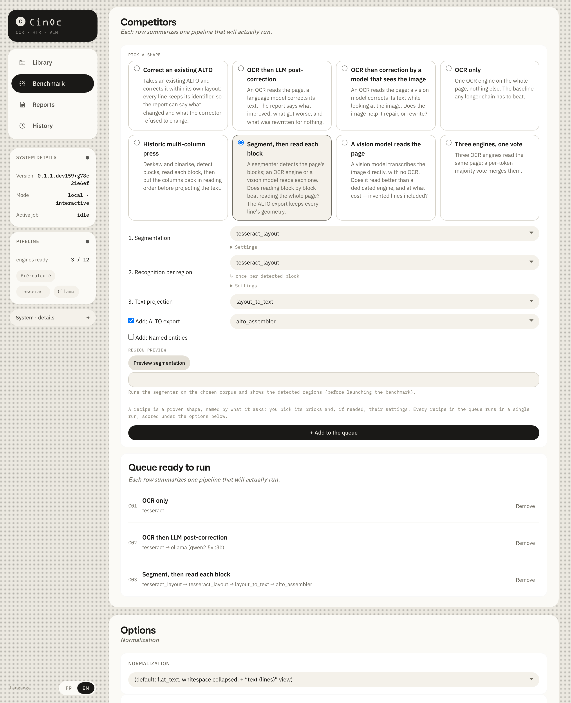

<div align="center">

# Cinoc

[](https://github.com/maribakulj/cinoc/actions/workflows/ci.yml)
[](https://www.python.org/)
[](LICENSE)
[](docs/guide.md#development)
[](docs/guide.md#invariants)

**A reproducible benchmark for transcription *pipelines* — OCR, HTR, VLM, OCR→LLM — on heritage documents.**

</div>

Transcribing a manuscript or a 19th‑century newspaper is now a *pipeline*: an
OCR engine, a vision model, an LLM that corrects — and each can lower the error
rate while inventing text. Cinoc runs competing pipelines over **your** corpus and
its ground truth, and writes a **self‑contained HTML report** of metrics and
significance tests. No LLM writes the report: every number is an auditable
function of the inputs.


## A first report in two minutes

```bash
pip install "cinoc @ git+https://github.com/maribakulj/cinoc"   # `pip install cinoc` once 1.0 is on PyPI
cinoc demo --output report.html                                  # then open report.html
```

No engine, no key, no network after the install. That report is built from
frozen outputs; your own pages are next.

## A first real OCR, on your pages

Put your page images beside their transcriptions (`page_001.png` +
`page_001.gt.txt`), zip them, and install the [`tesseract`](https://tesseract-ocr.github.io/)
binary (`apt install tesseract-ocr`, `brew install tesseract`):

```bash
cinoc corpus import zip pages.zip --dest corpus          # writes corpus/corpus.yaml
cinoc run corpus/corpus.yaml --recipe ocr_simple --set ocr.lang=eng \
    -o report.html --json corpus/run.json                # Tesseract, scored, reported
```

`ocr_simple` is one of the **recipes** (`cinoc list recipes`): OCR then an LLM,
a vision model reading the page, segment‑then‑read, three engines and a vote…
Queue several and they are compared in one report. `cinoc list engines` says
which engines your install can run, and *why* one cannot (an extra, a binary, a key).

To browse it in the web app — the same report served with its page images, a
corpus library, and the composer to launch runs from the page:

```bash
pip install "cinoc[serve,images] @ git+https://github.com/maribakulj/cinoc"
cinoc serve --reports-dir corpus                         # http://127.0.0.1:8000
```

`--reports-dir` serves the `RunResult` JSON of that folder and reads its images
against it: write `--json` beside the run config, as above.

## A real result — partial

The reference campaign (`campaigns/2026-11-26-reference/`) compares OCR,
segmentation, structured correction and vision models on two public corpora.
Only its **keyless half** has run so far: Tesseract, and a 3‑billion‑parameter
vision model run locally on CPU. Character error rate (CER, view `texte`) and
word error rate, micro‑averaged, read from the committed `RunResult`:

| corpus | pipeline | CER | WER | pages scored |
|---|---|---|---|---|
| `37-GT-BNL` (Luxembourg press, French + German Fraktur) | E0 · tesseract | 0.0584 | 0.2372 | 37/37 |
| | E1 · segmentation → tesseract | 0.0639 | 0.2521 | 37/37 |
| | E5 · qwen2.5vl:3b (local) | 0.0341 | 0.1559 | 37/37 |
| Dresden `Mscr.Dresd.K.80` (1665, German Kurrent hand) | E0 · tesseract | 0.7563 | 0.9987 | 10/10 |
| | E5 · qwen2.5vl:3b (local) | 1.8614 | 2.4843 | 4/10 |

Read them as what they are: one unpublished run, no repetitions, a small local
model — not a ranking. On the handwritten corpus Tesseract has no Kurrent model
and the small VLM hallucinates (a CER above 1) or exceeds its 600 s limit on six
pages. **The complete figure** — Mistral OCR, Mistral as corrector and as vision
model, five repetitions each, then the published dataset that lets anyone
re‑score it offline — comes with the next two steps of the campaign, which wait
for the maintainer's key and agreement. Protocol, conventions, estimated cost
and every other view: [`campaigns/2026-11-26-reference/README.md`](campaigns/2026-11-26-reference/README.md).

## Three things people come to do

| You have… | You run | |
|---|---|---|
| transcriptions from another tool (text or ALTO) | `precomputed` reads `page.<label>.txt` beside each image — no engine | [guide](docs/guide.md#scoring-ocr-that-cinoc-did-not-produce) |
| a corpus and several candidate engines | `cinoc run` with recipes or a full YAML spec | [guide](docs/guide.md#the-run-config) |
| ALTO to post‑correct inside its layout | `cinoc correct alto/` (extra `[saknussemm]`) | [guide](docs/guide.md#getting-a-corpus) |

Each of these is run end to end on the **installed wheel** by CI
(`tests/installed/`).

## Commands

| Command | What it does |
|---|---|
| `cinoc demo` | a demo report, no engine required |
| `cinoc run` | run a spec or a queue of recipes; `--check` reads the plan without running it, `--resume-dir` archives every unit, `--offline` re‑scores the archive without calling any engine |
| `cinoc correct` | structured post‑correction of existing ALTO, line by line |
| `cinoc hybrid` | segment, then OCR each block, then one ALTO per page |
| `cinoc compare` | compare two `RunResult` (deltas) |
| `cinoc history` | one pipeline over time, or which pipelines regressed |
| `cinoc corpus` | import (IIIF, Gallica, eScriptorium, HuggingFace, ZIP), search, standardize |
| `cinoc list` | engines, models, profiles, prompts, recipes — what this install can do |
| `cinoc serve` | the local web app (extra `[serve]`) |

## Documentation

- [`docs/guide.md`](docs/guide.md) — the user guide: what is measured and why,
  installation extras, the run config, recipes, corpora, correction, the web app
  and the Space, development.
- [`docs/PLUGINS.md`](docs/PLUGINS.md) — writing a third‑party brick (the only
  extension point).
- [`deploy/README_SPACE.md`](deploy/README_SPACE.md) — the HuggingFace Space.
- [`MIGRATION_PLAN.md`](MIGRATION_PLAN.md) — decision log; [`CHANGELOG.md`](CHANGELOG.md);
  working contract: [`CLAUDE.md`](CLAUDE.md).

```bash
pip install -e ".[dev]" && make check-fast   # contributing: ruff + mypy + the whole suite
```

## Screenshots

<details>
<summary><strong>The benchmark composer</strong> — queue recipes, choose their bricks and settings, launch one compared run.</summary>


</details>

<details>
<summary><strong>Layout & hybrid transcription</strong> — segment a page, then transcribe block by block.</summary>


</details>

## The name

*Cinoc* is a nod to a character in the fiction of **Georges Perec**.

## License

Apache‑2.0.
